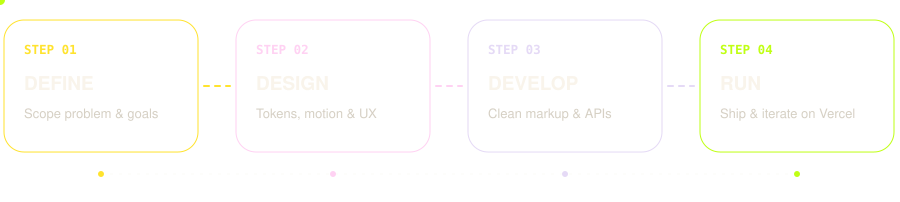

<div align="center">
  
</div>

Personal portfolio website of **Parth Singh**, Software Engineer at Flexera GCC, building scalable cloud platforms, distributed systems, FinOps, and Agentic AI solutions.

**Live site:** [portfolio-2025-two-ecru.vercel.app](https://portfolio-2025-two-ecru.vercel.app/)

## Overview

A multi-page, design-forward portfolio built on the **Squiggle UI** design system with scroll-driven animations, condensed editorial typography, and a clean layout walking visitors through background, experience, projects, and skills.

## Pages

<div align="center">
  
</div>

| Page | File | What it covers |
|---|---|---|
| **About** | `index.html` | Introduction, work summary timeline, and contact form |
| **Experience** | `index2.html` | Professional experience across strategy, design, and development |
| **Projects** | `index3.html` | Selected projects |
| **More** | `index4.html` | Education, skills, achievements, and contact details |

## Work Process

<div align="center">
  
</div>

## Highlights

- Animated hero section with scroll-based interactions
- Work process breakdown: **Define -> Design -> Develop -> Run**
- Timeline of roles: Flexera GCC, Finvolv, Irdeto, To The New, PES University, DPS Greater Noida
- Working contact form backed by `api/contact.js` and `server.js` using Nodemailer
- Component library and tokens documented with Storybook in `design-system/`
- Links to resume, LinkedIn, GitHub, and previous portfolio versions
- Responsive layout with SEO and Open Graph / Twitter Card metadata

## Tech Stack

- **Markup / Styling:** HTML5, CSS3, Squiggle UI design tokens (`design-system/tokens/tokens.css`)
- **Scripting:** Vanilla JavaScript (`main/scripts/app.js`)
- **Contact Backend:** Node.js, Nodemailer (`server.js`, `api/contact.js`)
- **Design System:** Storybook (`design-system/`)
- **Hosting / Deployment:** [Vercel](https://vercel.com/) (`vercel.json`)

## Getting Started

Clone the repository and run it locally:

```bash
git clone https://github.com/prth1234/portfolio-2025.git
cd portfolio-2025
```

Serve the static site directly, or start the Node.js server if testing the contact form:

```bash
# Option 1: Static server with Python
python3 -m http.server 3000

# Option 2: Static server with Node
npx serve .

# Option 3: Local server with contact API
npm install
npm start
```

Then visit `http://localhost:3000`.

### Environment Variables

If running the Nodemailer contact form (`server.js` / `api/contact.js`), configure `.env` based on `.env.example`:

| Variable | Description | Default |
|---|---|---|
| `SMTP_HOST` | SMTP server hostname | `smtp.gmail.com` |
| `SMTP_PORT` | SMTP server port | `465` |
| `EMAIL_USER` | Sender email address | — |
| `EMAIL_PASS` | 16-character SMTP app password | — |
| `CONTACT_RECEIVER_EMAIL` | Destination address for contact form submissions | `dearparthsingh@gmail.com` |

## Project Structure

```text
portfolio-2025/
├── main/               # Primary site pages, scripts, styles, and Vercel entrypoints
│   ├── index.html      # About
│   ├── index2.html     # Experience
│   ├── index3.html     # Projects
│   ├── index4.html     # More (education, skills, achievements, contact)
│   └── api/contact.js  # Serverless contact endpoint
├── design-system/      # Squiggle UI tokens, CSS, components, and Storybook
├── api/contact.js      # Contact API handler
├── server.js           # Local Node.js server
└── vercel.json         # Vercel routing configuration
```

## Deployment

The site is deployed on Vercel. Every push to `main` triggers a new production deployment.

```bash
npm i -g vercel
vercel
```

## Previous Versions

- [Portfolio 2024](https://prth1234.github.io/portfolio-2024/)
- [Portfolio 2023](https://prth1234.github.io/Parths-Website/)
- [Portfolio 2022](https://prth1234.github.io/happy-lemon-portoflio/)

## Connect

- **GitHub:** [@prth1234](https://github.com/prth1234)
- **LinkedIn:** [parthsingh2002](https://www.linkedin.com/in/parthsingh2002/)
- **Email:** dearparthsingh@gmail.com

## License

Copyright Parth Singh. All rights reserved. Please do not copy this site's content or design without permission.

<div align="center">
  
</div>
