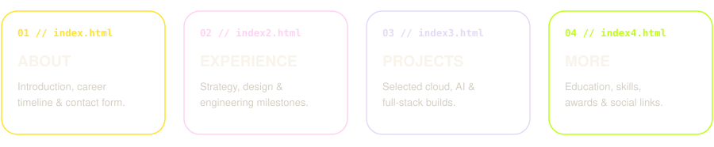

<div align="center">
  
</div>

Personal portfolio website of **Parth Singh**, Software Engineer at Flexera GCC, building scalable cloud platforms, distributed systems, FinOps, and Agentic AI solutions.

**Live site:** [portfolio-2025-two-ecru.vercel.app](https://portfolio-2025-two-ecru.vercel.app/)

## Overview

A multi-page, design-forward portfolio with scroll-driven animations, condensed editorial typography, and an interactive four-route walkthrough of Parth's background, engineering experience, selected projects, and skills.

## Interactive Routes

<div align="center">
  
</div>

| Route | File | What it covers |
|---|---|---|
| `/` | `main/index.html` | Introduction, work summary timeline, and interactive contact form |
| `/index2.html` | `main/index2.html` | Professional experience across strategy, design, and engineering |
| `/index3.html` | `main/index3.html` | Selected cloud, AI, and full-stack projects |
| `/index4.html` | `main/index4.html` | Education, skills, achievements, and contact details |

## Work Process

<div align="center">
  
</div>

## Highlights

- Scroll-driven animations and interactive section transitions across all four pages
- Work process breakdown: **Define -> Design -> Develop -> Run**
- Career & academic timeline: Flexera GCC, Finvolv, Irdeto, To The New, PES University, DPS Greater Noida
- Working contact form backed by `api/contact.js` and `server.js` using Nodemailer
- Links to resume, LinkedIn, GitHub, and previous portfolio editions
- Responsive layout with SEO and Open Graph / Twitter Card metadata

## Tech Stack

- **Markup / Styling:** HTML5, CSS3 (`styles/`, `main/`)
- **Scripting:** Vanilla JavaScript (`main/scripts/app.js`)
- **Contact Backend:** Node.js, Nodemailer (`server.js`, `api/contact.js`)
- **Hosting / Deployment:** [Vercel](https://vercel.com/) (`vercel.json`)

## Getting Started

```bash
git clone https://github.com/prth1234/portfolio-2025.git
cd portfolio-2025

# Option 1: Static server with Python
python3 -m http.server 3000

# Option 2: Static server with Node
npx serve .

# Option 3: Local Node.js server with contact API
npm install
npm start
```

Then visit `http://localhost:3000`.

<details>
<summary><b>Environment Variables (Contact Form API)</b></summary>

<br/>

If running the Nodemailer contact form (`server.js` / `api/contact.js`), configure `.env` based on `.env.example`:

| Variable | Description | Default |
|---|---|---|
| `SMTP_HOST` | SMTP server hostname | `smtp.gmail.com` |
| `SMTP_PORT` | SMTP server port | `465` |
| `EMAIL_USER` | Sender email address | — |
| `EMAIL_PASS` | 16-character SMTP app password | — |
| `CONTACT_RECEIVER_EMAIL` | Destination address for contact form submissions | `dearparthsingh@gmail.com` |

</details>

<details>
<summary><b>Project Structure</b></summary>

<br/>

```text
portfolio-2025/
├── main/               # Primary site pages, scripts, data, and Vercel entrypoints
│   ├── index.html      # About
│   ├── index2.html     # Experience
│   ├── index3.html     # Projects
│   ├── index4.html     # More (education, skills, achievements, contact)
│   └── api/contact.js  # Serverless contact endpoint
├── styles/             # Global and page-level stylesheets
├── design-system/      # Design tokens, reusable components, and Storybook
├── api/contact.js      # Contact API handler
├── server.js           # Local Node.js server
└── vercel.json         # Vercel routing configuration
```

</details>

<details>
<summary><b>Design System (Squiggle UI &amp; Storybook)</b></summary>

<br/>

Under the hood, the portfolio's visual tokens (`design-system/tokens/tokens.css`) and reusable UI primitives live in `design-system/` (Squiggle UI) and are documented with Storybook.

</details>

## Deployment

Deployed on Vercel — every push to `main` triggers a new production deployment:

```bash
npm i -g vercel
vercel
```

## Previous Versions

- [Portfolio 2024](https://prth1234.github.io/portfolio-2024/)
- [Portfolio 2023](https://prth1234.github.io/Parths-Website/)
- [Portfolio 2022](https://prth1234.github.io/happy-lemon-portoflio/)

## Connect

- **GitHub:** [@prth1234](https://github.com/prth1234)
- **LinkedIn:** [parthsingh2002](https://www.linkedin.com/in/parthsingh2002/)
- **Email:** dearparthsingh@gmail.com

## License

Copyright Parth Singh. All rights reserved. Please do not copy this site's content or design without permission.

<div align="center">
  
</div>
